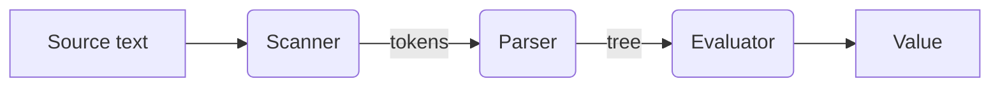

The parser reads tokens and builds a syntax tree. Mermaid diagrams are drawn in the browser; the button under each one opens it full screen.

## The pipeline



## Precedence

Each level of precedence is one function:

```go
func (p *Parser) expression() Node { return p.term() }

func (p *Parser) term() Node {
	left := p.factor()
	for p.match("+", "-") {
		op := p.previous()
		left = Binary{op, left, p.factor()}
	}
	return left
}
```
