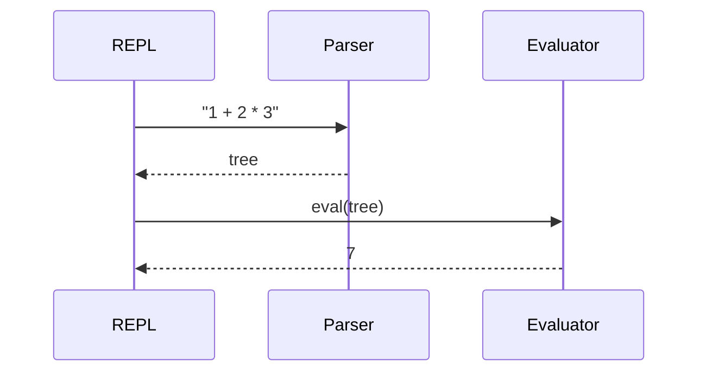

The last part walks the tree. This time in Rust, to show another language in the code theme.

```rust
fn eval(node: &Node) -> f64 {
    match node {
        Node::Number(n) => *n,
        Node::Binary(op, l, r) => {
            let (a, b) = (eval(l), eval(r));
            match op {
                '+' => a + b,
                '-' => a - b,
                '*' => a * b,
                _ => a / b,
            }
        }
    }
}
```

## One evaluation, step by step


